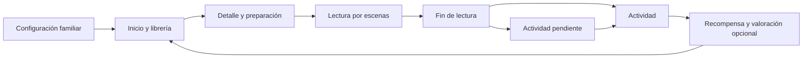

# Arquitectura técnica

Cuentico es una aplicación local con Next.js App Router, React, TypeScript estricto, estilos compartidos y una API del mismo origen. Prisma 6 accede a un archivo SQLite. No requiere servicios cloud ni proveedores de autenticación.

## Capas

| Capa | Responsabilidad |
| --- | --- |
| `src/app/` | Rutas, layout y endpoint HTTP |
| `src/components/` | Elementos compartidos de presentación |
| `src/modules/` | Comportamiento de lectura, perfiles, actividades y recordatorios |
| `src/core/contracts.ts` | Contratos de comandos, estado y respuestas |
| `src/server/` | Validación, autorización de la familia local, reglas persistentes y transacciones |
| `prisma/` | Esquema, migraciones y seed |
| `content/` | Manifiestos de cuentos y consejos importados |
| `public/assets/` | Copias de los medios originales que usa el navegador |

La API recibe comandos tipados en `/api/app`, valida su estructura en servidor y devuelve el estado de la familia seleccionada. Los componentes no escriben directamente en SQLite. Los manifiestos permiten añadir contenido sin introducir componentes por cuento.

## Flujos y consistencia

Una sesión registra inicio, escena actual, estado y duración activa. Existe exactamente una actividad asignada por sesión. Finalizar la lectura actualiza el progreso y desbloquea el personaje en una operación consistente; completar la actividad es una transición distinta. Las restricciones únicas de SQLite impiden duplicar favoritos, desbloqueos y la actividad de una sesión.

El navegador mide intervalos con una fuente monotónica, excluye pestañas ocultas, pausa manual, suspensión e inactividad. Se envía un total absoluto acumulado, que el servidor conserva de forma monotónica. Repetir el mismo guardado o finalizar dos veces no vuelve a sumar el tiempo. Se mantiene el progreso al reanudar; releer se expresa como una nueva sesión.

Los efectos de escena se declaran en el contenido mediante tipo, disparador, demora, recurso y duración. La ausencia de audio es un estado válido. El sonido sólo puede iniciarse tras una interacción del usuario y existe una preferencia global de silencio. La reducción de movimiento desactiva las animaciones no esenciales.

## Identidad local y privacidad

La primera creación de perfil emite una cookie HttpOnly con un identificador familiar aleatorio. La API filtra las operaciones por esa familia y por el perfil activo. La cookie no contiene el nombre del niño. Las peticiones de otro origen se rechazan y la base de datos no se sirve como archivo público.

El rol adulto en la interfaz es una barrera de uso, no una comprobación legal de edad ni una contraseña. Para un despliegue comercial se necesita autenticación familiar, autorización administrativa en servidor, recuperación de acceso, eliminación/exportación de datos y una revisión legal de los tratamientos.

Se recogen alias, edad de 6 o 7 años, intereses y preferencias. No hay correo obligatorio, publicidad, analítica de terceros ni grabaciones. Los recursos tipográficos se sirven localmente.

## Recordatorios y evolución

La rutina especifica días de semana, hora y zona horaria IANA. La programación calcula la próxima ocurrencia local, con independencia de la zona del servidor. Las categorías son actividad pendiente, próxima lectura y motivación. La preferencia desactivada suprime su categoría y una actividad completada no conserva un aviso pendiente.

La entrega actual ocurre dentro de la aplicación. Una interfaz de entrega permite incorporar push posteriormente, pero no existe infraestructura que despierte el navegador cerrado.

Universe, Library y LibraryEntitlement preparan la incorporación de otras bibliotecas y acceso PremiumLocked/Purchased. La biblioteca inicial es Free. No hay pagos en este MVP.
